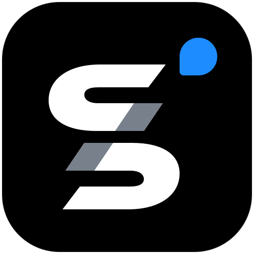
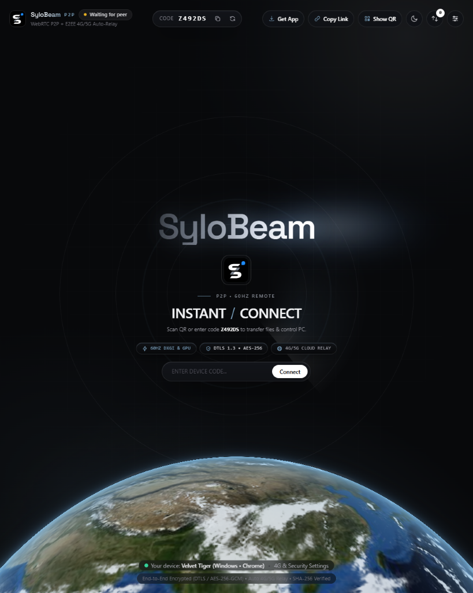
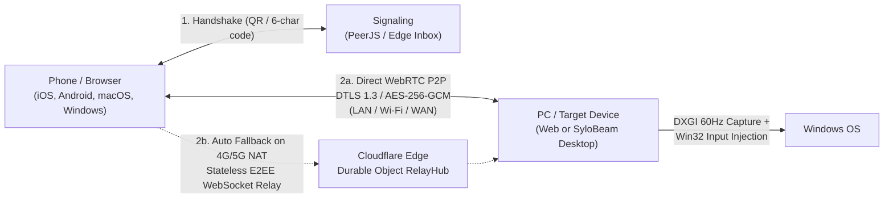
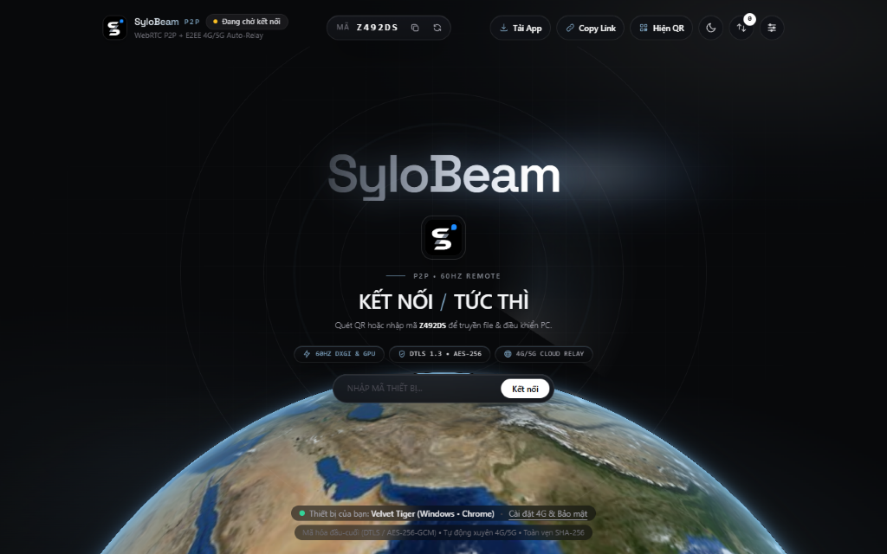

<div align="center">
  
  <h1>SyloBeam</h1>
  <p><strong>Zero-Friction P2P File Transfer &amp; 60Hz Remote Desktop Control — Direct over Wi-Fi, LAN &amp; 4G/5G</strong></p>

  <p>
    <a href="https://sylobeam.pages.dev/"></a>
    
    
    
  </p>

  <p>
    <a href="https://sylobeam.pages.dev/"><strong>Open Web App</strong></a> ·
    <a href="#how-it-works">How It Works</a> ·
    <a href="#option-2-windows-desktop-app-60hz-dxgi-remote-control--auto-save-folder">Windows App</a> ·
    <a href="https://github.com/nghtrung180905-afk/sylobeam/releases/latest"><strong>Download Release</strong></a> ·
    <a href="#tiếng-việt--giới-thiệu-nhanh">Tiếng Việt</a>
  </p>
</div>

---



## Why SyloBeam?

**SyloBeam** lets you send original-quality photos, multi-gigabyte videos, files, clipboard text, and **remotely control your Windows PC at up to 60Hz** straight from your phone or another computer — with **no login, no cloud file storage, and no file size limits**.

* **Instant Pairing:** Open [`sylobeam.pages.dev`](https://sylobeam.pages.dev/) on both devices, scan the QR code or enter the 6-character code, and connect in seconds.
* **True Peer-to-Peer Speed:** Files stream directly device-to-device via **WebRTC DataChannel** with adaptive `256 KB` LAN / `64 KB` cellular chunking and backpressure flow control — zero RAM crashes even on mobile Safari/Chrome.
* **Works Behind Strict 4G/5G NAT:** Automatically upgrades or falls back to a stateless **Cloudflare Edge E2EE WebSocket Relay** (Durable Objects) when symmetric mobile NAT blocks direct WebRTC.
* **60Hz Remote Desktop (PC ↔ Mobile/Web):** Native **DXGI Desktop Duplication (`IDXGIOutputDuplication`)** + WebRTC hardware video encoding + unordered low-latency UDP DataChannel for responsive touch/trackpad mouse, pinch-to-zoom, and full Vietnamese/Unicode keyboard input.
* **End-to-End Security:** Encrypted transport (**DTLS 1.3 / AES-256-GCM**), **6-digit SAS** verification code, **two-way explicit consent** before any file transfer or remote control, **SHA-256** per-file integrity check, and instant **`Ctrl + Alt + Esc`** emergency kill switch on PC.
* **Modern Studio UI:** Built-in **English / Tiếng Việt** language switcher in Settings, dual **Dark Mode** & **Lightning (Light) Mode**, real-time **WebGL 3D NASA Blue Marble Earth** with rotating satellite cloud layer, custom download folder picker, and installable PWA.

---

## How It Works



1. **Zero-Knowledge Architecture:** Files and screen frames are never persisted on any server. On LAN/Wi-Fi, traffic stays 100% inside your local network.
2. **Three-Tier Adaptive Screen Engine:**
   * **Tier 1 (GPU WebRTC H.264/VP8):** Hardware-accelerated video stream via Edge/Chrome MediaStream (`NVENC` / `QuickSync` / `AMF`).
   * **Tier 2 (Native DXGI Desktop Duplication):** Lightweight C# binary (`desktop-app/SwiftDropCapture.cs`) capturing directly in VRAM at ~4ms per frame with live resolution/FPS switching.
   * **Tier 3 (Unordered Fast-UDP / Relay Fallback):** Automatically keeps remote control responsive over 4G/5G.
3. **Zero External CDN Runtime Dependencies:** All libraries (`PeerJS`, `qrcode.js`), fonts (`Space Grotesk`), and NASA satellite Earth textures are self-hosted under strict `Content-Security-Policy: default-src 'self'`.

---

## Quick Start

### Option 1: Use Online Instantly (No Install)
1. Open **[https://sylobeam.pages.dev/](https://sylobeam.pages.dev/)** on Device A and Device B.
2. Scan the QR code or enter the 6-character device code and click **Kết nối**.
3. Confirm the two-way prompt and drag-and-drop files or start remote control.

### Option 2: Windows Desktop App (60Hz DXGI Remote Control + Auto-Save Folder)
1. Download **`SyloBeam-Setup.exe`** from the [Releases](../../releases) page (or click **Tải App** on [`sylobeam.pages.dev`](https://sylobeam.pages.dev/)).
2. Run `SyloBeam-Setup.exe` to install SyloBeam with Desktop & Start Menu shortcuts and Windows uninstaller support.
3. Press **`Ctrl + Alt + Esc`** at any time to immediately revoke remote control.

### Option 3: Run Locally / Self-Host
No build step is required for the static web frontend:

```bash
# Serve locally with Node.js or Python
npx serve -l 8080
# or
python -m http.server 8080
```

To self-host the optional 4G/5G Cloudflare Edge Relay:
```bash
cd swiftdrop-edge-vn
npx wrangler deploy
```

---

## Comparison & Trade-offs

| Feature | **SyloBeam** | AirDrop | PairDrop / LocalSend | AnyDesk / Parsec |
| :--- | :--- | :--- | :--- | :--- |
| **Platform support** | **Browser (Any OS) + Windows App** | Apple ecosystem only | Cross-platform | Requires native app on both ends |
| **Account / Login required** | **No** (QR / 6-char code) | Apple ID | No | Required on Parsec / cloud sync |
| **File size & speed limits** | **Unlimited** (Direct WebRTC P2P) | Unlimited | Unlimited (Local Wi-Fi / WebRTC) | Limited / Not built for raw photo drops |
| **Works across 4G/5G NAT** | **Auto E2EE Edge Relay fallback** | Local proximity only | Local Wi-Fi (PairDrop needs custom TURN for cellular) | Built-in proprietary relays |
| **PC Remote Control** | **60Hz DXGI + Touchscreen + Pinch-Zoom** | No | No | Yes (AnyDesk/Parsec core focus) |
| **Self-hostable & Open Source** | **MIT License** | Proprietary | Open Source (GPL / MIT) | Closed Source |

### Strengths (Pros)
* **All-in-one without bloat:** Combines PairDrop/AirDrop-grade instant file transfer with browser-accessible **60Hz Windows remote control** in a zero-login web app and a tiny ~1.2 MB Windows installer.
* **True zero-friction cross-OS pairing:** Share original photos/videos between iPhone, Android, macOS, Linux, and Windows over local Wi-Fi or cellular 4G/5G without installing anything on the phone.
* **Privacy by architecture:** Zero server file persistence, per-file SHA-256 verification, 6-digit SAS anti-MITM confirmation, and two-way explicit consent on every connection.

### Honest Limitations & Trade-offs (Cons)
* **1-to-1 active session per code:** Each room supports **2 paired devices at a time** (optimized for secure Phone ↔ PC or Person ↔ Person links rather than multi-user broadcast hubs).
* **Remote desktop host is Windows-only:** While any OS/browser can send/receive files and *control* a PC, the **60Hz DXGI host screen-capture & Win32 mouse/keyboard agent** currently runs on Windows only (macOS/Linux host agents are not implemented yet).
* **Browser RAM limit for gigantic files:** In web-only mode on mobile Safari, saving massive single files (multi-GB) buffers via browser blobs (whereas the Windows Desktop App writes incoming chunks safely to your chosen disk folder).
* **Unsigned Windows installer (`SyloBeam-Setup.exe`):** Because no commercial EV code-signing certificate is bundled yet, Windows SmartScreen may show a warning on first run (*More info → Run anyway*).
* **Free-tier signaling / relay dependency:** Default public `0.peerjs.com` signaling or Cloudflare Workers Free Tier Relay (`100k requests/day`) can throttle under heavy public 4G/5G relay traffic unless self-hosted or upgraded.

---

## Project Structure

```text
├── index.html                    # Main PWA interface (Dark & Lightning themes)
├── app.js                        # WebRTC P2P engine, 256KB chunking, E2EE Relay, Remote Control & WebGL 3D Earth
├── styles.css                    # Self-hosted precompiled Tailwind + custom studio theme
├── sw.js                         # Service Worker offline cache
├── manifest.json                 # PWA manifest
├── _headers                      # Strict CSP & security headers for Cloudflare Pages
├── assets/                       # Logo SVG/ICO, Space Grotesk font, NASA Blue Marble + Clouds textures
├── vendor/                       # Self-hosted PeerJS & QRCode libraries
├── desktop-app/                  # Windows Native Launcher, DXGI Capture, Win32 Input, Installer & Electron wrapper
└── swiftdrop-edge-vn/            # Stateless Cloudflare Worker + Durable Object E2EE Relay
```

---

## Tiếng Việt — Giới Thiệu Nhanh

**SyloBeam** là phần mềm **truyền file P2P tốc độ cao** và **điều khiển máy tính từ xa 60Hz** hoạt động ngay trên trình duyệt & Windows, không cần đăng nhập và không lưu file lên máy chủ trung gian:

* **Truyền ảnh gốc, video, file dung lượng lớn không giới hạn:** Chạy thẳng giữa điện thoại và máy tính qua Wi-Fi/LAN hoặc tự động xuyên mạng 4G/5G.
* **Điều khiển PC mượt 60Hz từ điện thoại:** Hỗ trợ cảm ứng trực tiếp & trackpad, phóng to/thu nhỏ 2 ngón, gõ tiếng Việt đầy đủ, chụp màn hình siêu nhanh bằng DXGI GPU.
* **Bảo mật đầu-cuối:** Mã hóa DTLS / AES-256-GCM, mã xác thực 6 số SAS, hỏi xác nhận hai chiều, kiểm tra toàn vẹn SHA-256 từng file và phím tắt ngắt khẩn cấp `Ctrl + Alt + Esc`.
* **Giao diện song ngữ & 3D:** Hỗ trợ chuyển **Tiếng Việt / English** trong Cài đặt, chế độ tối **Dark** & sáng **Lightning**, mô phỏng Trái Đất 3D vệ tinh NASA theo thời gian thực.
* **Dùng ngay:** Truy cập **[https://sylobeam.pages.dev/](https://sylobeam.pages.dev/)** hoặc tải bộ cài Windows **`SyloBeam-Setup.exe`** từ trang [Releases](https://github.com/nghtrung180905-afk/sylobeam/releases/latest).

### Ưu điểm & Nhược điểm so với các phần mềm khác

**Ưu điểm nổi bật:**
* **2 trong 1 gọn nhẹ:** Vừa truyền ảnh/video/file gốc không giới hạn như AirDrop / PairDrop / LocalSend, vừa **điều khiển PC 60Hz (cảm ứng chạm, Trackpad, zoom 2 ngón, gõ tiếng Việt)** ngay trên trình duyệt điện thoại mà không cần cài thêm app remote riêng.
* **Không kén hệ điều hành & không cần tài khoản:** Chạy chéo iPhone ↔ Android ↔ macOS ↔ Windows tức thì qua mã QR hoặc mã 6 ký tự.
* **Tự động xuyên 4G/5G:** Khác với nhiều tool P2P miễn phí chỉ chạy được trong cùng mạng Wi-Fi, SyloBeam tự chuyển sang **Cloudflare Edge Relay mã hóa E2EE** khi mạng di động chặn P2P.
* **An toàn & Minh bạch:** Không lưu file lên server, bắt buộc xác nhận 2 chiều, đối chiếu mã SAS 6 số, kiểm tra SHA-256 và bấm `Ctrl + Alt + Esc` để ngắt quyền điều khiển ngay lập tức.

**Nhược điểm / Giới hạn hiện tại (cần biết trước khi dùng):**
* **Kết nối 1-đối-1 theo phiên:** Mỗi phòng chỉ ghép tối đa **2 thiết bị cùng lúc** (chưa hỗ trợ phát broadcast cho nhiều máy nhận cùng một file một lúc).
* **Máy được điều khiển (Host) mới hỗ trợ Windows:** Điện thoại hay macOS có thể truyền file và *điều khiển* máy tính Windows 60Hz, nhưng chưa có phần mềm Host để điều khiển ngược lại macOS hay Linux.
* **File quá nặng trên trình duyệt điện thoại:** Gửi file vài chục GB cùng lúc hoàn toàn tốt giữa 2 máy qua App Windows lưu thẳng xuống ổ cứng; còn nếu nhận trực tiếp trên trình duyệt iOS/Safari, bộ nhớ RAM trình duyệt có giới hạn tự nhiên với file siêu lớn.
* **Cảnh báo SmartScreen lần đầu trên Windows:** Vì bộ cài `SyloBeam-Setup.exe` là bản cộng đồng chưa mua chứng thư ký số trả phí (EV Code Signing), lần đầu mở trên máy mới Windows sẽ hỏi xác nhận (*More info → Run anyway*).
* **Giới hạn hạ tầng miễn phí cho Relay 4G/5G:** Truyền P2P cùng Wi-Fi không giới hạn, nhưng nếu cực nhiều người cùng bật chế độ **xuyên 4G/5G qua Relay** miễn phí cùng lúc sẽ chạm hạn mức 100.000 request/ngày của gói Cloudflare Free (có thể tự host lại trong 1 lệnh `wrangler deploy`).



---

## License

Released under the [MIT License](./LICENSE).
